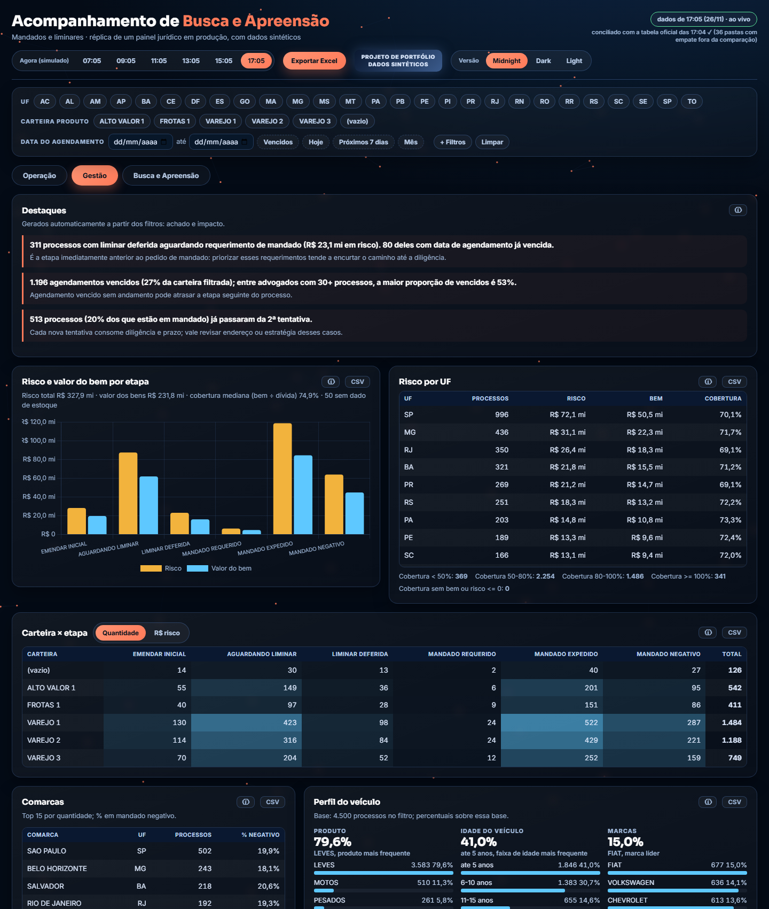
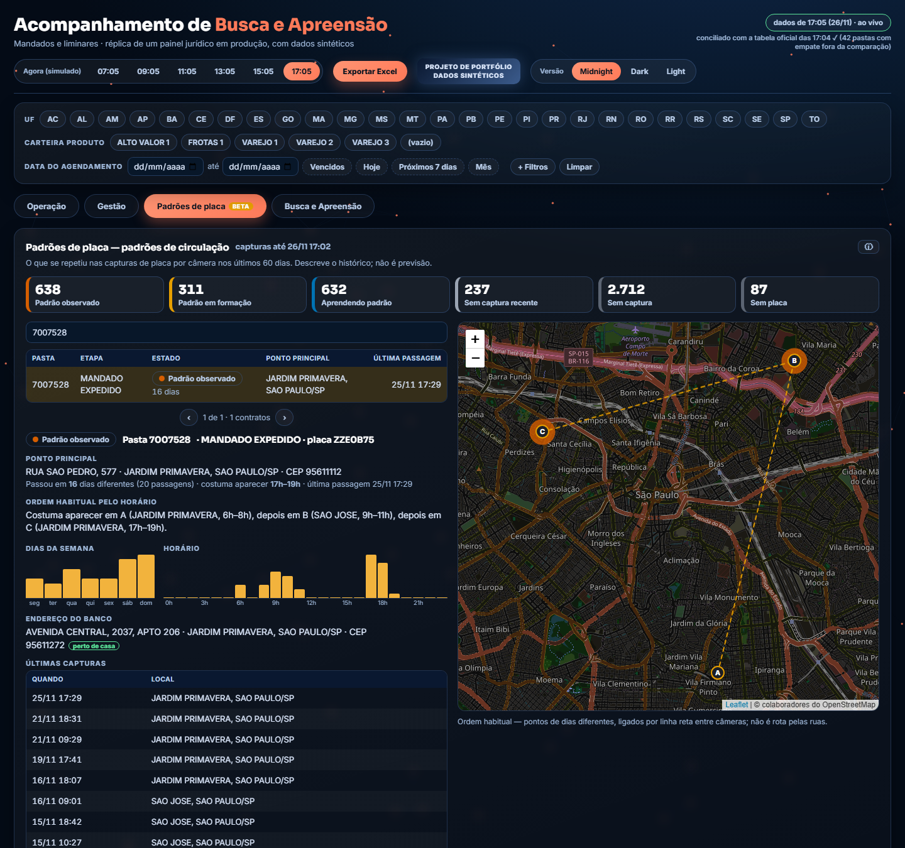

# Acompanhamento de Busca e Apreensão: réplica de um painel jurídico, com dados sintéticos

**Painel ao vivo:** https://alajunior.github.io/acompanhamento-busca-apreensao/ · dados 100% sintéticos · projeto de portfólio

Quando o cliente para de pagar o financiamento do veículo e nem a cobrança nem a entrega amigável resolvem, o caso vai para o jurídico: ação de **busca e apreensão**. O processo anda por etapas (emenda da inicial, aguardando liminar, liminar deferida, mandados) e cada etapa vira uma tarefa com prazo no sistema do escritório.

Este painel responde às perguntas do jurídico:
- **O que fazer hoje:** o que vence, onde está cada processo, quem está sobrecarregado.
- **Onde trava e quanto vale:** quanto risco há em cada etapa e quanto do valor o veículo cobre.
- **Onde está o veículo:** quais placas as câmeras de leitura viram, onde e em que etapa está o processo, e que padrão de circulação se repete.

É a réplica de um painel que construí e mantenho em produção, com o código escrito do zero. A mesma base do meu painel de Monitoramento (fotos do dia, travas de publicação, evolução) aplicada à área jurídica.

> **Todos os dados são sintéticos**, gerados por [`dados/gerar.py`](dados/gerar.py): processos, advogados (`ADV-01`…`ADV-24`), clientes (`CLIENTE 000123`), placas (começam por `ZZ`) e CPFs (mascarados). As comarcas são municípios reais, o que é geografia pública. Nenhum dado de cliente ou de empresa.


## Como usar (2 minutos)

1. **"Agora (simulado)", no topo.** O painel real atualiza a cada 30 minutos; aqui você escolhe o horário do dia simulado (26/11/2026). Dois horários mostram as travas em ação:
   - **11:05:** a leitura veio incompleta, a guarda de volume rejeita a rodada e o painel continua com a publicação anterior;
   - **13:05:** a via ao vivo cai e o painel publica a tabela oficial (o selo muda para "tabela oficial");
   - **15:05:** a leitura das capturas de placa falha, e o card Veículo localizado mantém a carga das 13:05, com aviso.
2. **Filtros** (valem para todas as abas e para a exportação): UF, carteira, data do agendamento (com os atalhos Vencidos, Hoje, Próximos 7 dias e Mês), advogado, etapa e produto do veículo.
3. **Aba Operação:**
   - KPIs com variação contra o início do dia e contra o dia anterior;
   - **Veículo localizado:** pastas vistas por câmera em 24 horas, 7 e 30 dias, por etapa com a sugestão do que fazer, as capturas mais recentes ("há 13 min") e as cidades;
   - escada de mandados e prazos por etapa;
   - carteira por advogado, com os sinais "carga alta" e "vencidos alto";
   - **mapa clicável**, por processos ou por veículos localizados: escolha um ou mais estados e o **Detalhe da região** compara cada UF com o Brasil (1 UF, 2 a 4 lado a lado, ou 5+ em tabela);
   - movimentação do dia.
4. **Aba Gestão:** destaques escritos por regra, risco × valor do bem, cobertura, carteira × etapa, comarcas, perfil do veículo e a evolução diária por etapa.
5. **Aba Padrões de placa (BETA):** o que se repetiu nas capturas dos últimos 60 dias, por pasta:
   - seis estados (padrão observado, em formação, aprendendo, sem captura recente, sem captura, sem placa);
   - lista com busca por pasta ou placa e o detalhe da pasta: ponto principal, ordem habitual pelo horário (A → B → C), área, dias da semana, horário e endereço do banco ("perto de casa");
   - mapa de ruas (OpenStreetMap) com os pontos, a sequência e a área. Link direto: [`?aba=padroes&pasta=7007528`](https://alajunior.github.io/acompanhamento-busca-apreensao/?aba=padroes&pasta=7007528).
6. **Aba Busca e Apreensão:** o modo planilha, com as três tabelas dinâmicas da planilha original do jurídico (Produtivos, Follow e Em diligência).
7. **Exportar Excel:** um `.xlsx` com os filtros ativos (BD com as 62 colunas, Resumo, Prazos, Advogados, Movimentação, Localizados, Padroes, Filtros e, com UF escolhida, Regiões). Cada card também tem seu **CSV**.

Os cards de análise têm um botão **ⓘ** com o "como ler". São três temas (Midnight, Dark e Light), e o painel funciona no celular.



## O que tem por trás

| Parte | Como funciona | Onde |
|---|---|---|
| **Simulação** | Cerca de 17 mil processos ao longo de ~1.000 dias. Cada um nasce no contencioso, é ajuizado e anda pelas etapas até a apreensão ou a saída por acordo. Cada etapa é uma tarefa aberta com prazo, reagendada a cada 25 a 60 dias quando a etapa demora. Os tempos são calibrados pelo funil real (tabela abaixo) | [`dados/gerar.py`](dados/gerar.py) |
| **A regra** | Agenda de tarefas abertas → **uma linha por pasta** (62 colunas). Ficam só os 21 tipos válidos; uma tarefa BAIXADO tira a pasta inteira. Vence o dia de agendamento mais recente; no mesmo dia, **LIMINAR DEFERIDA > EMENDAR INICIAL > AGUARDANDO LIMINAR** (só quando todas as tarefas do dia estão nesse trio); depois decidem a hora e o maior ID | [`src/regra.py`](src/regra.py) |
| **Travas de publicação** | Toda publicação vira foto. Rodada com menos de **85%** das linhas da anterior é rejeitada (aceita se a seguinte confirmar a queda, com até 2% de diferença). Se a via ao vivo falha, entra a tabela oficial | [`src/publicacao.py`](src/publicacao.py) |
| **Conciliação** | A "tabela oficial" simulada reproduz a procedure real, que escolhe **ao acaso** entre tarefas do mesmo dia. A conciliação compara por tipo (fora as pastas com empate), por carteira e por pasta, com tolerância de max(5, 2%) | [`src/conciliacao.py`](src/conciliacao.py) |
| **Capturas de placa** | Cerca de 20 mil capturas sintéticas. Cada veículo visto tem uma rotina de 1 a 3 pontos fixos (casa, trabalho, outro) perto de uma cidade real, com hora típica e dias sorteados, mais capturas esparsas; alguns são vistos em outra UF. Vêm com os defeitos da fonte real: placa com traço e minúscula, coordenada vazia ou (0,0), texto "undefined", duplicatas, acento na cidade | [`dados/capturas.py`](dados/capturas.py) |
| **Padrões** | Para cada carga de capturas (os horários do "agora"): células de ~330 m, ponto principal (mais dias distintos), estado pelos dias (≥ 6, 4–5, 1–3), faixa de 2 h circular (23h–1h vale), sequência com letras, área por envoltória convexa e distância haversine, e o "perto de casa" pelo prefixo do CEP | [`src/padroes.py`](src/padroes.py) |
| **Payload** | 44 fotos (39 dias de histórico, sem domingo, mais as 5 de hoje). A primeira vai inteira; as demais, só como **delta** do que mudou. As 6 cargas de capturas seguem o mesmo esquema. O painel cabe em um HTML de ~920 KB; o detalhe das placas (~2,1 MB) fica em `placas.json`, carregado só ao abrir a aba ou exportar | [`src/montar_painel.py`](src/montar_painel.py) |
| **Agregações** | Os filtros rodam no navegador ([`src/agregar.js`](src/agregar.js)). Uma referência independente em Python ([`src/referencia.py`](src/referencia.py)) calcula os mesmos números, e o **teste de paridade** roda o JS no Node e compara tudo em 52 combinações de filtros, mais a lista da aba Padrões e as bordas das janelas de 24 h, 7 e 30 dias | [`tests/test_paridade.py`](tests/test_paridade.py) |
| **Painel** | HTML, CSS e JS puro, Chart.js, um mapa do Brasil em SVG próprio e Leaflet com OpenStreetMap na aba Padrões. Animações respeitam `prefers-reduced-motion`. A exportação `.xlsx` é feita no navegador (SheetJS) | [`src/painel.html`](src/painel.html), [`src/exportar.js`](src/exportar.js) |

**Funil simulado contra o real** (mediana de dias antes da apreensão, só dos processos apreendidos):

| Marco | Real | Simulado |
|---|---|---|
| Entrada no contencioso | 170 | 176 |
| Ajuizamento | 71 | 76 |
| Liminar deferida | 34 | 35 |
| 1º mandado | 18 | 18 |
| Apreendidos no 1º mandado | 74% | 73,5% |

No dia simulado são **4.617 processos**, 27% com agendamento vencido e 42 pastas com empate de tarefas no mesmo dia. Nos empates entre AGUARDANDO LIMINAR e EMENDAR INICIAL, a etapa real é EMENDAR em cerca de 87%, a proporção medida no histórico do sistema real: é por isso que a precedência do fluxo põe EMENDAR na frente. A conciliação com a tabela oficial fecha nas três recargas.

Nas placas, às 17:05: 1.527 pastas tiveram o veículo visto em 30 dias (34% das que têm placa), 262 nas últimas 24 horas e 78 fora da UF do processo. Pelos padrões, 638 pastas estão em padrão observado, 311 em formação e 632 aprendendo.

## Decisões

- **Site estático, não servidor.** O painel real é um app Flask com atualizador. Aqui o Python faz o trabalho pesado (simulação, regra, travas, fotos) e o navegador só filtra e agrega. Assim o link abre na hora, inclusive no celular. O preço é ter as agregações em JavaScript, e é para isso que existe o teste de paridade com o Python.
- **A regra é a parte que mais importa.** Um painel jurídico vale o quanto bate com a fonte oficial. Cada defeito real que a regra precisa tratar aparece de propósito nos dados, cada um com um teste:
  - chave com espaço ou NBSP;
  - tipo de tarefa com caixa trocada;
  - BAIXADO junto de tarefas abertas;
  - empates no mesmo dia;
  - veículo com cor nula.
- **Empate não é erro da regra.** A procedure oficial escolhe ao acaso entre duas tarefas do mesmo dia. Por isso a conciliação deixa essas pastas fora da comparação por tipo, e o painel aplica a precedência do fluxo nelas.
- **Uma etapa extinta, como na vida real.** EMENDA REALIZADA deixa de existir em 03/11: as tarefas abertas migram para AGUARDANDO LIMINAR. A evolução conta os dias antigos à parte, com aviso, em vez de sumir com eles.
- **Os estados de falha são encenados.** No painel real, a guarda de volume e a queda para a tabela oficial só aparecem quando acontecem. Aqui eles ficam em horários fixos do "agora", para quem avalia ver as travas funcionando.
- **Padrões calculados no Python, não no navegador.** Os padrões dependem de geometria (células, envoltória convexa, haversine) e mudam pouco ao longo do dia. O Python calcula cada carga uma vez, e só as pastas cujas capturas mudaram são recalculadas e gravadas. O navegador só conta por filtro, e essas contagens também estão na paridade.
- **Detalhe sob demanda.** O resumo das placas vai no HTML, porque o card, o mapa e a lista precisam dele já na abertura. O detalhe de cada pasta fica no `placas.json` e só carrega quando a aba abre. Aberto como arquivo local, o painel avisa e o resto continua funcionando.
- **Limite conhecido da simulação:** os pontos das rotinas são sorteados num raio de 6 km do centro da cidade, sem máscara de terra, e os bairros são nomes genéricos sorteados por ponto. Em cidades litorâneas, alguns pontos caem no mar. Para o que o projeto mostra (a regra dos padrões e a tela), isso não muda nada; para um estudo geográfico, seria o primeiro ajuste.
- **Descreve, não prevê.** A aba Padrões diz onde o veículo costuma passar e em que horário, como no painel real. Não estima probabilidade de apreensão.
- **Nenhum nome de pessoa.** Advogados são códigos (um nome inventado pode coincidir com o de uma pessoa real) e os destaques nunca citam advogado.




## Como rodar

```bash
pip install -r requirements.txt
python -m dados.gerar --verificar      # simulação + conferência do funil (~15 s)
python -m src.montar_painel            # docs/index.html, docs/bd.json e docs/placas.json
python -m pytest                       # 130 testes (a paridade e a exportação precisam do Node)
```

Abra `docs/index.html` no navegador. Para o detalhe da aba Padrões e para as abas BD, Localizados e Padroes do `.xlsx`, sirva a pasta (`python -m http.server --directory docs`), porque o navegador não carrega `bd.json` nem `placas.json` de um arquivo local.

## Estrutura

```
dados/gerar.py               simulação dos processos e fontes (agenda, estoque, garantia, cor, distribuição)
dados/capturas.py            capturas de placa por câmera e endereços do banco
src/regra.py                 agenda → uma linha por pasta (21 tipos, precedência, empates, 62 colunas)
src/publicacao.py            fotos, guarda de 85%, queda para a tabela oficial, roteiro do dia simulado
src/conciliacao.py           nossa regra × tabela oficial
src/padroes.py               capturas → resumo do localizado e padrões de circulação, por carga
src/montar_painel.py         payload em delta + build de docs/index.html, docs/bd.json e docs/placas.json
src/agregar.js               agregações do painel (navegador e Node)
src/referencia.py            as mesmas agregações em Python, para a paridade
src/exportar.js              CSV por card e abas do .xlsx
src/painel.html              o painel (HTML, CSS e JS puro)
tests/                       130 testes: simulação, capturas, padrões, regra, travas, conciliação, payload, referência, paridade, exportação, guarda de publicação
docs/                        o painel publicado, a base da exportação e as imagens deste README
```

Bibliotecas e mapa de terceiros: ver [`LICENCAS.md`](LICENCAS.md).
